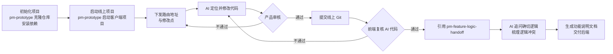
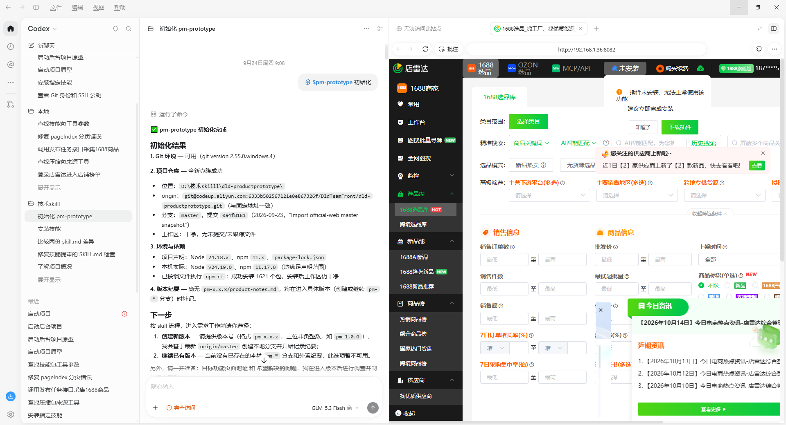
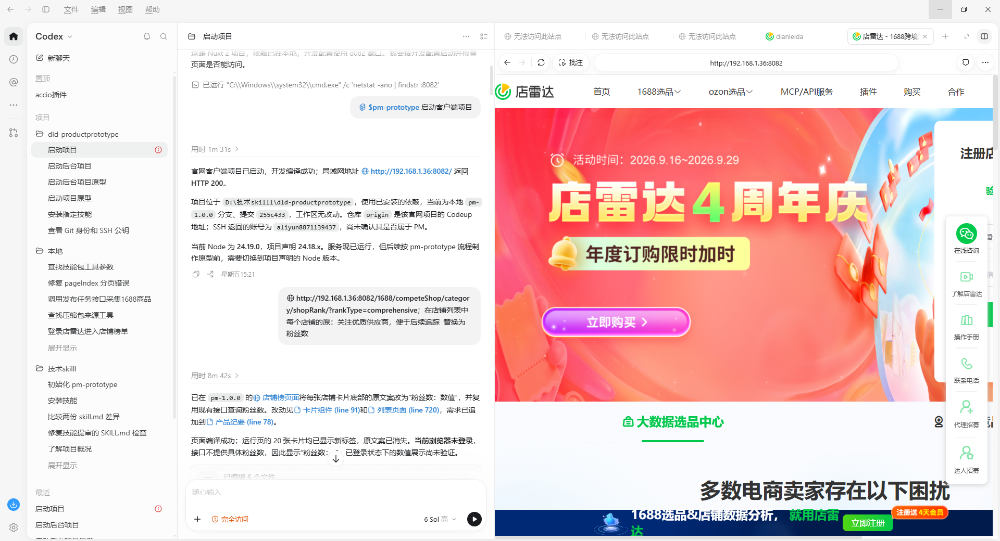
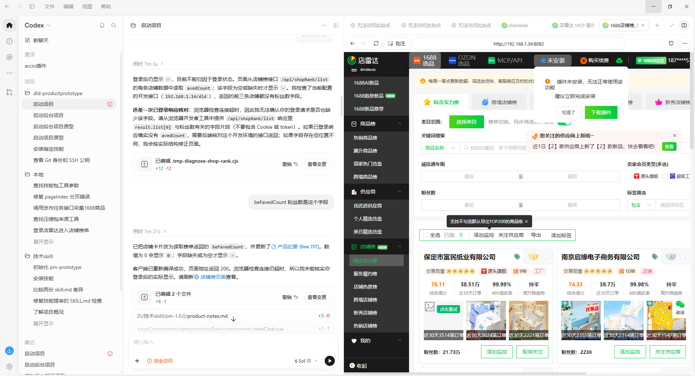
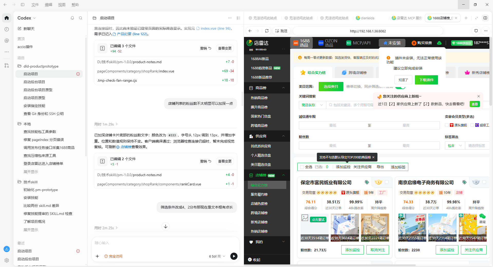
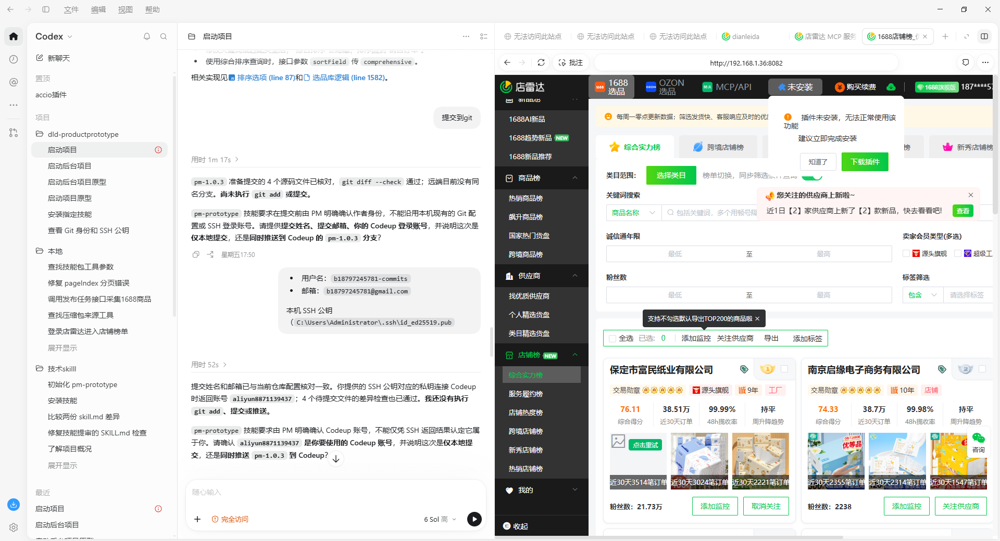
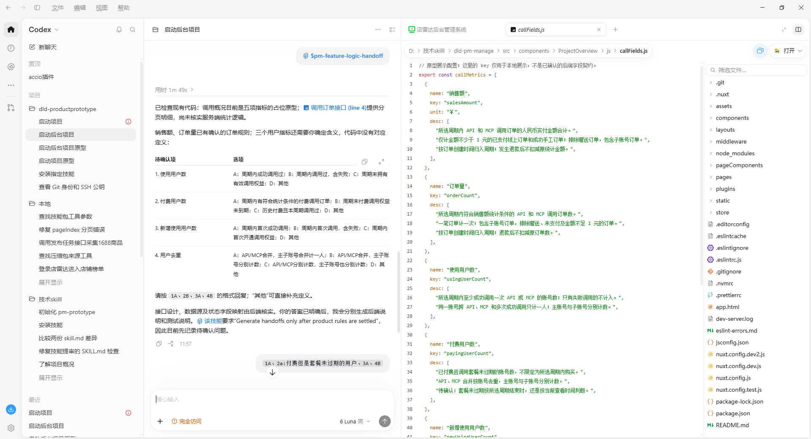
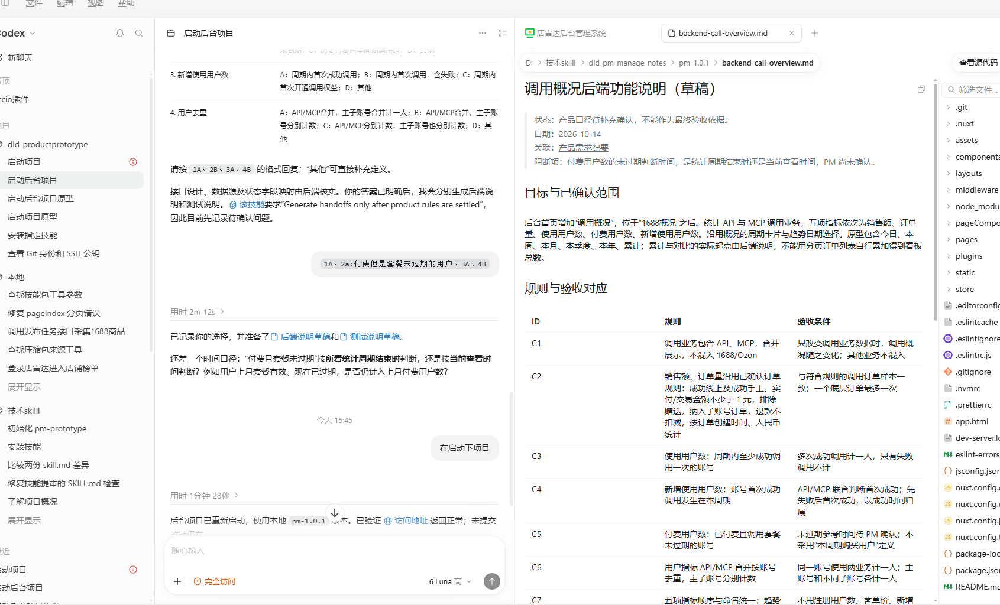

# 产品团队 AI 协作工作流程说明

产品团队目前把"改动需求"到"前后端交付"这条链路，拆成了五段，由自研的 pm-prototype 与 pm-feature-logic-handoff 两个技能承接其中的关键动作，AI 负责执行与追问，人在两个审核节点把关。下面按实际执行顺序说明每个环节的输入、动作、产出，并附上对应的产品侧操作与 AI 对话。

## 整体流程

整条链路有两个人工闸口：产品审核改动是否符合预期，前端复核 AI 产出的代码是否合理。AI 在初始化、启动、代码修改三个环节承担执行，在最后一个环节承担逻辑追问与文档生成。产品侧不直接接触代码，全部操作通过 AI 会话完成。

## 复杂功能与简单功能的差异处理

上面的五段流程是通用主干，落到具体改动时，按复杂度和牵涉页面数量分成两条路径。

复杂功能牵涉页面多、逻辑复杂。产品完成页面改动后，由前端对接接口，接口就绪后再更新上线。

简单交互牵涉页面少、逻辑不复杂。产品把页面改动连同接口一起对接完成，提交给前端审核代码，审核通过后直接更新到线上。

| 类型 | 判断标准 | 产品负责 | 前端负责 | 上线时机 |
| --- | --- | --- | --- | --- |
| 复杂功能 | 牵涉页面多、逻辑复杂 | 完成页面改动与逻辑说明 | 对接接口 | 接口就绪后更新上线 |
| 简单交互 | 牵涉页面少、逻辑不复杂 | 完成页面改动并自行对接接口 | 审核代码 | 审核通过后直接更新到线上 |

两条路径的产品侧操作一致，都通过 AI 会话完成改动，差别在于接口由谁对接，以及上线前是否还需要前端完成接口工作。

## 环节一：初始化项目

产品在 AI 工具中打开"初始化 pm-prototype"会话，由 pm-prototype 完成 Git 环境检查、仓库克隆与依赖安装，为后续改动准备一个可运行的前端工程。

- 输入：固定的前端仓库地址
- 动作：检查 Git 环境，克隆最新代码，安装依赖
- 产出：本地可运行的前端工程

AI：

> pm-prototype 初始化完成。
> 1. Git 环境可用（git version 2.55.0.windows.4）。
> 2. 项目仓库全新克隆成功：位置 D:\技术skill\dld-productprototype，分支 master，提交 2aae1b8b，工作区干净、无未提交文件。
> 3. 环境与依赖：项目声明 Node 24.18.x、npm 11.x；本机 Node v24.19.0、npm 11.17.0；npm ci 安装 1621 个包。
> 4. 脚本配置：尚无 package.json 与 product-notes.md，将在进入具体任务（创建或继续 pm-xxx）时补齐。

> 下一步：进入需求工作前，选择创建新版本（提供版本号，如 pm-1.8.0）或继续已有版本。

初始化完成后，前端工程即可在后续会话中启动并接受改动。改动对象是真实代码而不是设计稿，产品看到的页面与线上一致。

## 环节二：启动线上项目

产品在 AI 工具中打开"启动项目"会话，由 pm-prototype 的启动客户端项目能力启动项目。AI 先检查端口占用情况，再启动项目并回报运行状态。

- 输入：已初始化的前端工程
- 动作：检查端口，启动与线上一致的项目运行环境
- 产出：可实时预览、与线上实现一致的环境

用户：

> 分析前端项目默认启动路径是否存在性能问题，并启动项目。

AI（先执行端口检查，再启动 pm-prototype 客户端项目）：

> 当前项目已启动，开发编译成功；本地网址 http://192.168.1.36:8082/ 返回 HTTP 200。项目位于本地技术 skill 目录下的 dld-productprototype，当前为 pm-prototype-1.8.0 分支，提交 25e343c。当前 Node 为 24.19.0，项目声明 24.18.x，服务虽已运行，但按 pm-prototype 流程仍需切换到项目声明的 Node 版本。

## 环节三：下发路由与修改点，由 AI 执行改动

产品把目标页面的路由地址与具体修改点发给 AI，AI 定位代码后完成改动，并在回报中说明改动结果与尚未验证的部分。

- 输入：路由地址 + 修改点说明
- 动作：AI 定位对应代码并按描述修改
- 产出：可运行、可验证的改动结果

用户：

> http://192.168.1.36:8082/1688/competeShopCategory?gysOfferRank&rankType=comprehensive 店铺列表中每个店铺卡片底部的"关注优质供应商"改为"粉丝数"。

AI：

> 已在店铺页面把店铺卡片底部的"关注优质供应商"改为"粉丝数"，并复用已有逻辑函数。20 张卡片已显示新标签；但当前接口不提供粉丝数，因此显示"粉丝数：↓"，登录态下的数值展示尚未验证。

AI 在这条回报里主动点出了两处未确定的地方：接口不提供粉丝数、登录态下的数值展示未验证。当改动涉及 AI 不掌握的字段时，产品直接在会话里补充字段来源，AI 随即完成读取逻辑：

用户：

> befavoredCount 粉丝数是这个字段。

AI：

> 已把店铺卡片改为读取接口返回的 befavoredCount，并更新了产品经理需求（见 117 行）。数值为空显示 0，字段为空时显示 ↓。卡片页面逻辑完成，页面地址返回 200。

改动完成后，产品在运行环境中核对效果，对不满意的地方继续提优化要求，AI 逐条调整：

用户：

> 店铺列表的粉丝数不太明显可以深一点。

AI：

> 已调整店铺卡片底部粉丝数的样式：颜色改为 #333，字号从 12px 调到 13px，并增加字重，位置与数值显示保持不变。

"提出问题、AI 优化、再核对"的过程会持续若干轮，直到改动符合预期才进入下一环节。

## 环节四：提交线上 Git，前端复核

改动经产品确认后提交到线上 Git 仓库，由前端评审 AI 产出的代码是否合理，评审范围包括实现方式、代码风格以及是否引入风险。提交前，AI 会核对改动文件并检查差异，同时按 pm-prototype 流程要求产品明确提交身份与推送范围。

- 输入：已确认的改动 + 提交身份信息
- 动作：核对改动文件、检查差异，按产品确认的身份提交并推送到线上分支
- 产出：线上分支上的代码改动，供前端复核

用户：

> 提交到 git。

AI：

> pm-1.0.3 待提交的 4 个源码文件已核对，git diff --check 通过；远端目前没有同名分支，尚未执行 git add 或提交。按 pm-prototype 流程，提交前需由产品明确确认代码作者，不使用本机 Git 配置。请提供提交姓名、邮箱、Codeup 登录账号，并说明这次是仅本地提交，还是同时推送到 Codeup 的 pm-1.0.3 分支。

产品提供姓名、邮箱与本机 SSH 公钥后，AI 核对身份，再次请产品确认 Codeup 账号与推送范围。确认后提交到线上分支，交由前端复核代码是否合理。

这一步保留了前端对代码的最终控制权，AI 的产出需要经过真实工程标准的检验。

## 环节五：引用 pm-feature-logic-handoff 核实逻辑并生成功能说明文档

针对已提交的改动，引用自研的 pm-feature-logic-handoff 技能。AI 检查现有代码，找出缺失的逻辑以及和既有规则冲突的地方，把需要确认的项整理成选项请产品拍板；产品确认后，AI 生成功能说明文档交付后端。

- 输入：已提交的改动 + 对应的问题描述
- 动作：检查代码，核实缺失逻辑与冲突逻辑，逐项请产品确认
- 产出：功能说明文档（含后端说明与测试说明）

AI：

> 已检查现有代码：销售额、订单数已有确认的统计规则；三个用户指标目前仍是占位原型，代码中没有对应定义。需要确认的定义共 4 项，每项给出 A/B/C/D 选项，请按"1A+2B+3A+4B"的格式回复，有补充可追加。

用户：

> 3A+2A+2B，另外需要考虑老用户的情况。

AI：

> 产品确认明确后，我会分别生成后端说明文档和测试说明。pm-feature-logic-handoff 只对已确认的规则生效。

产品确认选择后，AI 生成功能说明文档（草稿）。文档按"规则 + 验收条件"逐条列出已确认的规则，并单独标出仍待确认的口径。

文档包含三部分：

- 状态与关联：标注草稿状态、日期与关联的产品需求记录，注明"产品口径待补充确认，不作为最终验收依据"
- 目标与已确认范围：后台新增"调用概览"，五项指标依次为销售额、订单量、新增用户数、付费用户数、新增付费用户数
- 规则与验收对应：按 ID 逐条列出规则与对应验收条件（调用业务范围、销售额与订单量口径、各项用户指标的去重与归属）

AI 同时提出仍待确认的口径问题（如付费用户数"未过期"是按统计周期末判断还是按当前时间判断），这类问题在产品确认前一直保留在文档的待确认清单里。

这一步把逻辑层面的问题从开发阶段提前到了提交阶段。后端拿到的是已经澄清过的逻辑说明，而不是需要自行猜测的口头需求。

## 角色分工

| 角色 | 在流程中承担的工作 |
| --- | --- |
| 产品 | 提供路由地址与修改点，在运行环境核对改动，补充字段与逻辑信息，触发逻辑追问 |
| AI | 初始化并启动项目、定位并修改代码、核实逻辑、生成功能说明文档 |
| 前端 | 复核 AI 代码是否合理，决定合入或调整 |
| 后端 | 依据功能说明文档开展后端实现 |

## 与原有方式的对比

| 维度 | 原有方式 | 当前方式 |
| --- | --- | --- |
| 需求表达 | 口头描述或静态原型，位置与效果依赖反复确认 | 直接落到真实代码与真实路由，所见即所得 |
| 改动执行 | 由前端承接，产品等待排期 | AI 先产出改动，前端聚焦复核 |
| 逻辑澄清 | 后端在开发阶段自行推导，问题暴露晚 | 会话中由 AI 主动追问，问题提前暴露 |
| 交付物 | 需求描述为主 | 代码改动 + 功能说明文档 |

## 当前局限与后续方向

追问逻辑的准确度取决于产品对改动的描述完整度，描述越清晰，AI 追问后产出的逻辑文档越贴近真实需求。AI 产出的代码仍需前端逐条复核，这一环节暂时无法省略。

后续可以考虑的方向：把功能说明文档与对应的代码改动、Git 提交关联起来，方便回溯；将高频改动的逻辑说明沉淀为模板，减少重复澄清。
